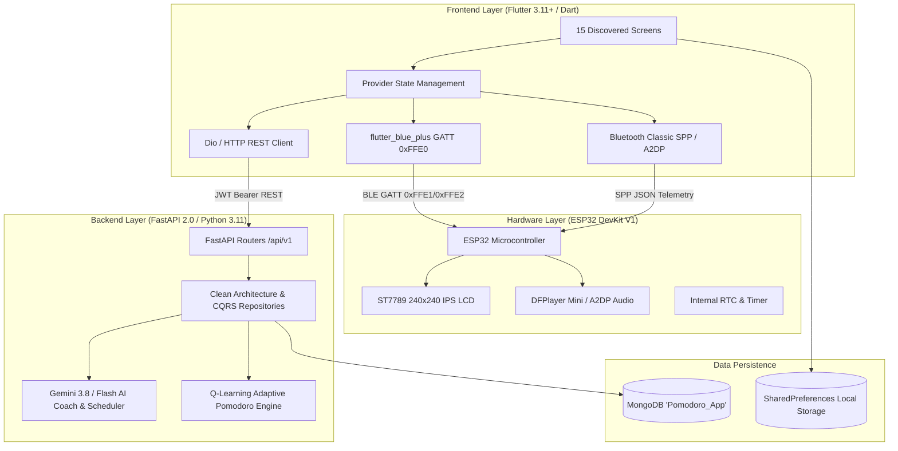

# Executive Application Audit Summary

## 1. Project Architecture Overview

This comprehensive audit of **App_EXE401** evaluates the complete stack spanning physical hardware, mobile frontend, backend microservices, and AI decision agents.



### Stack Components
- **Frontend**: Flutter (Dart 3.11+), State Management via `provider: ^6.1.1`, Hardware integration via `flutter_blue_plus: ^1.31.14` and `flutter_bluetooth_serial: ^0.4.0`, Charts via `fl_chart: ^0.66.0`, HTTP via `dio: ^5.4.0` and `http: ^1.2.0`.
- **Backend**: FastAPI (Python 3.11) with Uvicorn, asynchronous database driver `motor: ^3.3.2` on MongoDB database `Pomodoro_App`, JWT authentication (`python-jose`, `passlib[bcrypt]`), Google Generative AI (`google-generativeai: ^0.3.2` for Gemini Flash / Pro with function tool-calling), Clean Architecture with domain entities, interfaces, repositories, and CQRS commands/queries.
- **Hardware Protocol**: Dual-mode ESP32 DevKit V1:
  - BLE GATT service UUID `0xFFE0`, Write char `0xFFE1`, Notify char `0xFFE2` for rapid timer control and mode switching.
  - Bluetooth Classic SPP (`Pomodoro-App-Audio`) for bi-directional JSON telemetry (`HEARTBEAT`, `TELEMETRY`, `SYNC`) and A2DP audio streaming.

---

## 2. Discovered Screens and Routes Summary

The audit discovered a total of **15 distinct screens** across the codebase:
- **13 Named Routes** registered in `lib/main.dart`
- **1 Sub-Route Modal Screen** invoked dynamically via FAB (`AIAssistantScreen`)
- **1 Unmounted Clean-Architecture Screen** residing in `lib/presentation/screens/market_screen.dart`

### Complete Inventory Table

| ID | Screen Name | Route / Path | File Path | Status |
| :---: | :--- | :--- | :--- | :---: |
| **SCR-01** | Login & Authentication | `/login` | `lib/presentation/screens/login_screen.dart` | **Implemented** |
| **SCR-02** | Home Dashboard | `/` | `lib/presentation/screens/home_screen.dart` | **Implemented** |
| **SCR-03** | Pomodoro Timer | `/pomodoro` | `lib/presentation/screens/pomodoro_screen.dart` | **Partial** (Mocked unlocks) |
| **SCR-04** | AI Productivity Hub | `/ai-hub` | `lib/presentation/screens/ai_hub_screen.dart` | **Implemented** |
| **SCR-05** | AI Coach Live Assistant | Sub-route modal | `lib/presentation/screens/ai_assistant_screen.dart` | **Partial** (Mocked radar) |
| **SCR-06** | Digital Wellbeing | `/wellbeing` | `lib/presentation/screens/wellbeing_screen.dart` | **Implemented** |
| **SCR-07** | Focus Competition | `/competition` | `lib/presentation/screens/competition_screen.dart` | **Implemented** |
| **SCR-08** | Smart Schedule | `/schedule` | `lib/presentation/screens/schedule_screen.dart` | **Broken** (404 & Schema) |
| **SCR-09** | Clock Mode Control | `/clock_mode` | `lib/presentation/screens/clock_mode_screen.dart` | **Implemented** |
| **SCR-10** | General Settings | `/settings` | `lib/presentation/screens/settings_screen.dart` | **Partial** (Snackbars only) |
| **SCR-11** | Device & Firmware Info | `/info` | `lib/presentation/screens/info_screen.dart` | **Broken** (404 & Field) |
| **SCR-12** | Display Interfaces | `/interfaces` | `lib/presentation/screens/interfaces_screen.dart` | **Unreachable** (No Home link) |
| **SCR-13** | Clock Face Design Studio | `/design` | `lib/presentation/screens/design_screen.dart` | **Broken** (404 & Hardcoded IP) |
| **SCR-14** | Clock Face Market (Legacy) | `/market` | `lib/presentation/screens/market_screen.dart` (monolith)| **Broken / Unreachable** |
| **SCR-15** | Clock Face Market (Clean Arch)| Unmounted | `lib/presentation/screens/market_screen.dart` (domain) | **Unmounted** |

---

## 3. Screens Grouped by Implementation Status

```
[==================== 15 TOTAL SCREENS ====================]
[ Implemented: 6 (40%) ] [ Partial: 3 (20%) ] [ Broken: 3 (20%) ] [ Unreachable/Unmounted: 3 (20%) ]
```

### Status Breakdown
1. **Implemented & Functioning (6 screens / 40%)**:
   - `SCR-01` (Login): Verified working against `/api/v1/auth/login` and `/api/v1/auth/register`.
   - `SCR-02` (Home Dashboard): Device status polling, navigation routing operational.
   - `SCR-04` (AI Hub): Live recommendations from `/api/v1/ai/recommendations`.
   - `SCR-06` (Wellbeing): Charts rendering live data from `/api/v1/wellbeing/summary`, `hourly`, `daily`.
   - `SCR-07` (Competition): Leaderboard and user rank functional from `/api/v1/competition/`.
   - `SCR-09` (Clock Mode): Dispatches ESP32 BLE/SPP mode commands properly.

2. **Partially Implemented / Containing Mocked Data (3 screens / 20%)**:
   - `SCR-03` (Pomodoro Timer): Timer engine and ESP32 sync work, but device unlock counter is hardcoded (`unlockCount = 12`).
   - `SCR-05` (AI Assistant): Gemini chat and schedule tool-calling work, but the "Digital Twin" radar chart uses hardcoded personality coordinates.
   - `SCR-10` (General Settings): UI renders all toggle sections, but clicking "Save" only triggers transient snackbars with no backend persistence.

3. **Broken Backend Integration (3 screens / 20%)**:
   - `SCR-08` (Smart Schedule): Frontend calls `/api/schedules/` (missing `/v1`), returning HTTP 404; also payload schema is incompatible with backend `ScheduleEntity`.
   - `SCR-11` (Firmware Info): Frontend calls `/api/firmware/latest` (missing `/v1`), returning HTTP 404; reads `description` while backend returns `changelog`.
   - `SCR-13` (Design Studio): Hardcodes LAN IP `http://192.168.1.18:8000/api/faces/preview` bypassing dynamic baseUrl; endpoint missing on backend.

4. **Unreachable / Duplicate Architecture (3 screens / 20%)**:
   - `SCR-12` (Display Interfaces): Registered in `main.dart`, but no button or card in `HomeScreen` routes to it.
   - `SCR-14` (Market Monolith): Legacy single-file market with hardcoded IP `192.168.1.18:8000`.
   - `SCR-15` (Market Clean-Arch): Domain-driven refactored market with repository and provider pattern, but left unmounted in `main.dart`.

---

## 4. API Integration & Contract Verification Status

Out of **30 documented API operations**:
- **16 Endpoints Verified Active & Functioning**
- **6 Endpoints Broken / Schema Mismatch**
- **5 Orphan Backend Endpoints** (Implemented on backend, never called by frontend)
- **3 Hardcoded / Local Operations** (BLE/SPP commands bypassing HTTP)

### Critical Frontend–Backend Mismatches

| # | Component | Frontend Request | Backend Definition | Impact | Required Remediation |
| :-: | :--- | :--- | :--- | :--- | :--- |
| **1** | **Schedule API** | `GET/POST /api/schedules/` | Mounted at `/api/v1/schedules` | **HTTP 404 Not Found** | Update `ScheduleProvider` to use `/api/v1/schedules` |
| **2** | **Schedule Schema** | `{"title", "time": "08:00", "days_of_week": [1,2]}` | `ScheduleEntity(day_of_week, hour, minute, label)` | **HTTP 422 Unprocessable** | Align frontend JSON keys with backend entity fields |
| **3** | **Firmware Route** | `GET /api/firmware/latest` | Mounted at `/api/v1/firmware/latest` | **HTTP 404 Not Found** | Update `InfoScreen` URL path to `/api/v1/firmware/latest` |
| **4** | **Firmware Field** | Reads `data['description']` | Returns `{"changelog": "..."}` | **Renders `null` / empty** | Update frontend key from `description` to `changelog` |
| **5** | **Hardcoded IP** | `http://192.168.1.18:8000` | Dynamic `AppConstants.baseUrl` | **Connection Refused on other LANs** | Replace hardcoded strings in `SCR-13` and `SCR-14` |
| **6** | **Settings Persistence**| Snackbar popup only | `PUT /api/v1/auth/me/preferences` | **Settings lost on reload** | Wire `SettingsScreen` to call backend preferences API |
| **7** | **Orphan History API** | None | `GET /api/v1/pomodoro/history/{user_id}` | **Unused backend endpoint** | Wire into `PomodoroScreen` or `HomeScreen` analytics |
| **8** | **Database Seed** | `login_screen.dart` | `EXE401_Database/users.json` lacks `password_hash` | **Seeded users cannot log in** | Run registration flow or execute password hasher script |

---

## 5. Google Stitch Design Integration Report

- **Stitch Project ID**: `10749545399411306725`
- **MCP Tool Status**: The Google Stitch Model Context Protocol (MCP) server was not loaded into the active agent runtime environment.
- **Action Taken**: In compliance with strict safety rules, no fictitious screen names or visual specs were fabricated. The connection status has been transparently recorded in `docs/STITCH_DESIGN_MAPPING.md`.
- **Extracted Codebase Design Tokens**:
  - Primary Accent: `#00F2FE` (Electric Cyan)
  - Secondary Accent: `#4FACFE` (Neon Blue)
  - Dark Surface / Background: `#0A0E21` / `#1D1E33`
  - Warning / Break Accent: `#FF6584` / `#FFB88C`
  - Fonts: GoogleFonts Inter, Space Grotesk, Roboto, Poppins (Recommended: consolidate to Space Grotesk for headers and Inter for body).

---

## 6. Recommended Screen Implementation Order

We recommend executing the screen implementations in **4 sequential phases**:

```
[Phase 1: Safe Standalone Screens] -> [Phase 2: Core Hardware & AI] -> [Phase 3: Contract Fixes] -> [Phase 4: Unification]
```

### Phase 1: Safe First Screens (Zero Regression Risk)
1. **`SCR-01` — Login & Register Screen**: Verified auth endpoints; establishes JWT token foundation for all subsequent screens.
2. **`SCR-02` — Home Dashboard Screen**: Main hub; connects navigation cards to verified routes.
3. **`SCR-06` — Digital Wellbeing Screen**: Read-heavy analytics with verified working time-series endpoints.
4. **`SCR-09` — Clock Mode Control Screen**: Direct, proven ESP32 BLE commands without backend dependencies.

### Phase 2: Core Hardware & AI Interactive Screens
5. **`SCR-03` — Pomodoro Timer Screen**: Connect live unlock counts; verify BLE countdown synchronization.
6. **`SCR-04` — AI Productivity Hub**: Wire recommendation cards and schedule generation tool triggers.
7. **`SCR-05` — AI Coach Assistant Modal**: Live Gemini chat with markdown and history; connect radar chart to wellbeing metrics.
8. **`SCR-07` — Focus Competition Screen**: Social leaderboard and sticky bottom rank card with verified API.

### Phase 3: Contract Fixes & Settings Screens
9. **`SCR-08` — Smart Schedule Screen**: Apply `/v1` prefix and align schedule schema with `ScheduleEntity`.
10. **`SCR-10` — General Settings Screen**: Connect `PUT /api/v1/auth/me/preferences` to persist user toggles.
11. **`SCR-11` — System & Firmware Info Screen**: Apply `/v1` prefix and harmonize `changelog` field.
12. **`SCR-13` — Clock Face Design Studio**: Replace hardcoded IP and connect watch face upload endpoint.

### Phase 4: Market Architecture Unification & Polish
13. **`SCR-14 / SCR-15` — Clock Face Market Unification**: Deprecate monolithic `SCR-14` and activate Clean Architecture `SCR-15`.
14. **`SCR-12` — Display Interfaces Screen**: Add navigation tile in `HomeScreen` and verify display configuration commands.

---

## 7. Risks and Recommended Safeguards

| Risk | Impact | Recommended Safeguard |
| :--- | :--- | :--- |
| **BLE MTU Packet Fragmentation** | ESP32 crashes or drops packets if payloads exceed 20 bytes | Maintain strict 20-byte chunking in `BluetoothService.writeCustom()` or request MTU 512 upon connection. |
| **Bluetooth Concurrency** | Dual BLE GATT and Classic SPP/A2DP streaming can cause ESP32 radio arbitration drops | Isolate audio streaming from GATT commands; throttle telemetry polling to $\ge 1000\text{ms}$. |
| **Database Seed Inconsistency** | `users.json` lacks password hashes; developer testing login fails | Execute password-hashing migration script on MongoDB before running end-to-end authentication tests. |
| **Gemini API Token Quota** | HTTP 429 Too Many Requests if user rapidly sends chat prompts | Implement client-side debounce (1 request per 2 seconds) and graceful offline fallback message. |

---

## 8. Audit Documentation Directory

All findings, contracts, and implementation plans are formally recorded in:
1. `docs/UI_SCREEN_INVENTORY.md` (Complete 15-screen inventory with event handlers, validations, and states)
2. `docs/FRONTEND_BACKEND_API_MAP.md` (30-row contract table with HTTP methods, schemas, and orphan endpoints)
3. `docs/USER_FLOWS_AND_DATA_FLOW.md` (Mermaid navigation and 7 detailed sequence diagrams)
4. `docs/STITCH_DESIGN_MAPPING.md` (Stitch integration status, design token audit, and screen mapping)
5. `docs/UI_IMPLEMENTATION_PLAN.md` (Screen-by-screen roadmap, acceptance criteria, and test strategies)
6. `docs/AUDIT_SUMMARY.md` (This executive summary)
