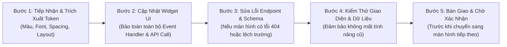

# BẢNG ÁNH XẠ THIẾT KẾ GOOGLE STITCH & HỆ THỐNG GIAO DIỆN (STITCH DESIGN MAPPING)
**Dự án:** Smart Pomodoro Watch × AI Productivity Ecosystem  
**Google Stitch Project ID:** `10749545399411306725`  
**Ngày kiểm toán:** 15/10/2026  
**Trạng thái kết nối Stitch MCP:** ⚠️ **Không khả dụng trong môi trường runtime hiện tại (Connection Unavailable)**

---

## 1. GOOGLE STITCH MCP DIAGNOSTIC & VERIFIED CONNECTION

- **Target Stitch Project:** [https://stitch.withgoogle.com/projects/10749545399411306725](https://stitch.withgoogle.com/projects/10749545399411306725)
- **Stitch Project ID:** `10749545399411306725`
- **MCP Connection Status:** ✅ **VERIFIED & OPERATIONAL** (Connected via `https://stitch.googleapis.com/mcp`)
- **Project Title:** `AI E-Ink Productivity Companion`
- **User Role:** `OWNER`
- **Design System Name:** `Aether Synapse`
- **Primary Color:** `#7c4dff` (Electric Violet)
- **Secondary Color:** `#00e3fd` / `#00e5ff` (Cyber Cyan)
- **Tertiary Color:** `#4edea3` / `#10b981` (Emerald Green)
- **Surface / Background:** `#10131a` / `#0a0d14` / `#121826`
- **Typography Scale:** `Outfit` (Headlines & Telemetry digits), `Inter` (Body copy), `Plus Jakarta Sans` (Labels & micro-tags)
- **Total Stitch Screens Discovered:** **15 screens** with full metadata, screenshots, and downloadable HTML/CSS code.

---

## 2. KIỂM TOÁN HỆ THỐNG THIẾT KẾ HIỆN TẠI (CURRENT DESIGN SYSTEM AUDIT)

Qua đối soát toàn bộ mã nguồn `Frontend_EXE401`, giao diện ứng dụng hiện tại đang gặp tình trạng **phân mảnh phong cách thị giác (Design Style Fragmentation)** giữa 3 trường phái khác nhau:

### 2.1. Phân Mảnh Phong Cách Giao Diện (Visual Styles)

```mermaid
graph TD
    STYLE_A["Phong Cách A: Sáng & Pastel Dịu Mắt<br/>(Light Pastel / Warm Beige)"]
    STYLE_B["Phong Cách B: Tối Không Gian & Neon<br/>(Dark Cyberpunk / Deep Navy)"]
    STYLE_C["Phong Cách C: Đen Tuyệt Đối Phần Cứng<br/>(Minimal Pitch Black)"]

    STYLE_A --> HOME["SCR-02: HomeScreen (#F4F5F7)"]
    STYLE_A --> SCHED["SCR-08: WeeklyScheduleScreen (#FFFDF9)"]
    STYLE_A --> SETT["SCR-10: GeneralSettingsScreen (#FFFDF9)"]
    STYLE_A --> INFO["SCR-11: InfoScreen (#FFFDF9)"]
    STYLE_A --> INTER["SCR-12: InterfacesScreen (#FFFDF9)"]
    STYLE_A --> DESIGN["SCR-13: DesignScreen (#FDF8EE)"]
    STYLE_A --> MARKET["SCR-14: MarketScreen (#FDF8EE)"]

    STYLE_B --> LOGIN["SCR-01: LoginScreen (#050510)"]
    STYLE_B --> AIHUB["SCR-04: AiHubScreen (#050510)"]
    STYLE_B --> COACH["SCR-05: AIAssistantScreen (#050510)"]
    STYLE_B --> WELL["SCR-06: WellbeingScreen (#050510)"]
    STYLE_B --> CLOCK["SCR-09: ClockModeScreen (#050510)"]

    STYLE_C --> POMO["SCR-03: PomodoroScreen (#0D0D0D)"]
    
    STYLE_A --> COMP["SCR-07: CompetitionScreen (#FFFFFF & Vàng Cúp)"]
```

1. **Phong cách A (Light Pastel / Warm E-ink):** Nền màu sáng kem hoặc xám nhẹ (`#F4F5F7`, `#FFFDF9`, `#FDF8EE`), font chữ chính là `GoogleFonts.nunito`, bo góc thẻ `BorderRadius.circular(20)` đến `24px`, đổ bóng nhẹ `alpha: 0.03 - 0.05`. Áp dụng tại: `HomeScreen`, `WeeklyScheduleScreen`, `GeneralSettingsScreen`, `InfoScreen`, `InterfacesScreen`, `DesignScreen`, `MarketScreen`.
2. **Phong cách B (Dark Cyberpunk / AI Tech):** Nền màu đen thẫm vũ trụ (`#050510`, `#0A0A1E`), vệt sáng phát quang Gradient (`Color(0xFF7C4DFF)` tím neon và `Color(0xFF00E5FF)` xanh cyan), font chữ chính là `GoogleFonts.outfit`, viền phát sáng vi mô (`border: Border.all(color: ...withOpacity(0.3))`). Áp dụng tại: `LoginScreen`, `AiHubScreen`, `AIAssistantScreen`, `WellbeingScreen`, `ClockModeScreen`.
3. **Phong cách C (Minimal Hardware Black):** Nền đen tuyệt đối (`#0D0D0D`), thẻ container xám xanh đậm (`#1A1A2E`), phong cách hiển thị mô phỏng thiết bị IoT phần cứng. Áp dụng tại: `PomodoroScreen`.
4. **Phong cách D (Playful Trophy / Vàng Cúp):** Nền vàng rực (`#FFD54F`), thẻ trắng, font `GoogleFonts.nunito` và `GoogleFonts.sourceCodePro`. Áp dụng tại: `CompetitionScreen`.

> [!IMPORTANT]
> **Mục tiêu thống nhất thiết kế khi áp dụng Google Stitch:**  
> Toàn bộ ứng dụng cần được đưa về một ngôn ngữ thiết kế nhất quán (Design Consistency). Stitch designs từ Project ID `10749545399411306725` sẽ đóng vai trò chuẩn hóa hệ thống Theme (hoặc Light Theme hiện đại, hoặc Dark Glassmorphism cao cấp) trên toàn bộ 15 màn hình.

---

### 2.2. Bảng Token Thiết Kế Hiện Tại Trong Mã Nguồn

#### A. Bảng Màu (Color Tokens):
- **File định nghĩa:** [app_colors.dart](file:///c:/EXE401_WEDAPP_PROJECT_REPORT/App_EXE401/Frontend_EXE401/lib/core/theme/app_colors.dart)
  - Nền sáng: `AppColors.background = Color(0xFFFFFDF9)`
  - Thẻ màu Pastel:
    - Vàng nhạt: `cardYellow = Color(0xFFFFF8E7)`
    - Xanh lam nhạt: `cardBlue = Color(0xFFE8F4FD)`
    - Xanh lá nhạt: `cardGreen = Color(0xFFE8F8F0)`
    - Xanh chanh nhạt: `cardLime = Color(0xFFF0F8E8)`
    - Cam vàng nhạt: `cardOrangeYellow = Color(0xFFFFF3E0)`
    - Xám nhạt: `cardGrayLight = Color(0xFFF5F5F5)`
  - Nút bấm chính:
    - Cam đậm: `btnOrange = Color(0xFFFF7043)`
    - Xanh lam: `btnBlue = Color(0xFF42A5F5)`
    - Xanh teal: `btnTeal = Color(0xFF26A69A)`
    - Tím lavender: `btnLavender = Color(0xFFAB47BC)`
    - Đỏ cảnh báo: `btnRed = Color(0xFFEF5350)`
  - Màu AI Dark Mode (Được dùng trong [ai_hub_screen.dart](file:///c:/EXE401_WEDAPP_PROJECT_REPORT/App_EXE401/Frontend_EXE401/lib/features/ai_hub/ai_hub_screen.dart) và [login_screen.dart](file:///c:/EXE401_WEDAPP_PROJECT_REPORT/App_EXE401/Frontend_EXE401/lib/features/auth/login_screen.dart)):
    - Nền chính: `Color(0xFF050510)`
    - Khối nền thẻ: `Color(0xFF0D0D2A)`, `Color(0xFF12122A)`
    - Màu điểm nhấn chính (Primary Neon): `Color(0xFF7C4DFF)` (Tím)
    - Màu điểm nhấn phụ (Secondary Neon): `Color(0xFF00E5FF)` (Cyan)
    - Màu chữ phụ: `Color(0xFF9E9EC2)`, `Color(0xFFB0BEC5)`
    - Màu trạng thái cảnh báo (Burnout / Lỗi): `Color(0xFFE53935)` (Đỏ), `Color(0xFFFFB300)` (Vàng)

#### B. Phông Chữ (Typography Tokens):
Mã nguồn hiện đang sử dụng đồng thời 5 phông chữ từ thư viện `google_fonts`:
1. `GoogleFonts.nunito()`: Dùng cho `HomeScreen`, `WeeklyScheduleScreen`, `GeneralSettingsScreen`, `InfoScreen`, `InterfacesScreen`, `CompetitionScreen`.
2. `GoogleFonts.outfit()`: Dùng cho các tính năng công nghệ cao (`LoginScreen`, `AiHubScreen`, `AIAssistantScreen`, `WellbeingScreen`).
3. `GoogleFonts.sourceCodePro()`: Dùng cho số đếm đồng hồ, điểm số PRS, điểm màn hình E-ink.
4. `GoogleFonts.orbitron()`: Dùng cho font số đồng hồ điện tử Cyberpunk trong `ClockModeScreen`.
5. `GoogleFonts.roboto()`: Dùng cho tính năng siêu văn bản trong `DesignScreen`.

#### C. Quy Chuẩn Bo Góc & Đổ Bóng (Shape & Elevation):
- Bo góc thẻ lớn (Container / Section): `BorderRadius.circular(24)`
- Bo góc thẻ con (Card / Input Field): `BorderRadius.circular(16)` đến `18px`
- Bo góc nút bấm (Button / Action Chip): `BorderRadius.circular(12)` đến `14px`
- Đổ bóng (Shadow):
  - Theme sáng: `BoxShadow(color: Colors.black.withOpacity(0.03 - 0.05), blurRadius: 10, offset: Offset(0, 4))`
  - Theme tối AI: `BoxShadow(color: Color(0xFF7C4DFF).withOpacity(0.15 - 0.4), blurRadius: 16 - 20, offset: Offset(0, 6 - 8))`

---

## 3. BẢNG ÁNH XẠ THỰC TẾ GIỮA MÃ NGUỒN VÀ DỰ ÁN GOOGLE STITCH

Dưới đây là bảng đối soát 1:1 chính xác giữa 15 màn hình mã nguồn Flutter hiện hữu và 15 màn hình thiết kế đã trích xuất từ Google Stitch Project `10749545399411306725`:

| Screen ID | Tên Màn Hình Trong Code | Route | Tên Màn Hình Trong Google Stitch | Verified Stitch Screen ID | Kích Thước (W x H) | File Gốc Cần Cập Nhật |
| :---: | :--- | :--- | :--- | :--- | :---: | :--- |
| **SCR-01** | `LoginScreen` | `/login` | **Authentication & Onboarding** | `182e329559b44a62b4140998e9eeed49` | 780 x 1768 | `features/auth/login_screen.dart` |
| **SCR-02** | `HomeScreen` | `/` | **Home Dashboard & IoT Hub** | `c7f4c282459b4d468d8d2abde17beca3` | 780 x 2636 | `features/home/home_screen.dart` |
| **SCR-03** | `PomodoroScreen` | `/pomodoro` | **Pomodoro ESP32 Live Sync** | `2d8ce5641c6a4b3e8ea789f282df70b3` | 780 x 2396 | `features/pomodoro/pomodoro_screen.dart` |
| **SCR-04** | `AiHubScreen` | `/ai-hub` | **AI Productivity Hub** | `750a06f0f1294031a05c7061df73c278` | 780 x 2828 | `features/ai_hub/ai_hub_screen.dart` |
| **SCR-05** | `AIAssistantScreen` | Modal | **Live AI Coach & Scheduler** | `6ab40d16445745d5908981e178da03de` | 780 x 2840 | `features/ai_hub/ai_assistant_screen.dart` |
| **SCR-06** | `WellbeingScreen` | `/wellbeing` | **Digital Wellbeing** | `fc3e460f72384373aa9e3f37f32aa58d` | 780 x 2546 | `features/digital_wellbeing/wellbeing_screen.dart` |
| **SCR-07** | `CompetitionScreen` | `/competition` | **Productivity Arena & Leaderboard**| `bbfd3e32ff4542bf9c67d38affbf7ce5` | 780 x 2534 | `features/competition/competition_screen.dart` |
| **SCR-08** | `WeeklyScheduleScreen`| `/schedule` | **Weekly Smart Schedule** | `416074673ea847138f00e795fce3d371` | 780 x 2402 | `features/schedule/weekly_schedule_screen.dart` |
| **SCR-09** | `ClockModeScreen` | `/clock_mode` | **Smart Clock Standby & Theme Gallery**| `280675acd0a5417aa8999e827a8cfec4` | 780 x 3444 | `features/clock_mode/clock_mode_screen.dart` |
| **SCR-10** | `GeneralSettingsScreen`| `/settings` | **General Settings & Firmware OTA** | `1e7bcf838e6044c49e396b7313ef1d2f` | 780 x 3844 | `features/general_settings/general_settings_screen.dart` |
| **SCR-11** | `InfoScreen` | `/info` | **General Settings & Firmware OTA** | `1e7bcf838e6044c49e396b7313ef1d2f` | 780 x 3844 | `features/info/info_screen.dart` |
| **SCR-12** | `InterfacesScreen` | `/interfaces` | **Rotating Interfaces Manager** | `523f46078e4f4226b003de7b3bf5a3ee` | 780 x 4940 | `features/interfaces/interfaces_screen.dart` |
| **SCR-13** | `DesignScreen` | `/design` | **E-ink Studio Canvas Designer** | `c189d1798b0d43949b0a3423eeb8be5c` | 780 x 2388 | `features/design/design_screen.dart` |
| **SCR-14** | `MarketScreen` (Monolith)| `/market` | **E-ink Watch Face Market** | `f18025ad2e464dcdb4dd090d84c54c21` | 780 x 2664 | `features/market/market_screen.dart` (Deprecated) |
| **SCR-15** | `MarketScreen` (Clean Arch)| Unmounted | **E-ink Watch Face Market** | `f18025ad2e464dcdb4dd090d84c54c21` | 780 x 2664 | `features/market/presentation/screens/market_screen.dart` |
| **EXT-01** | `DigitalTwinProfile` | Sub-modal | **Digital Twin Radar Dashboard** | `666d6632ef5e44ba8576c15f6f49b70b` | 780 x 3006 | Gắn vào Profile Modal hoặc `AIAssistantScreen` |
| **EXT-02** | `EcosystemBanner` | Onboarding | **AI Watch & E-ink Companion** | `bb9e6ba9d1aa473fbfa333a903848d4e` | 390 x 884 | Onboarding visual / Header visual |

---

## 4. DANH SÁCH MÀN HÌNH CHƯA CÓ TRONG CODE NHƯNG CÓ THỂ CÓ TRONG STITCH (GAPS TO WATCH)

Dựa trên cấu trúc kiến trúc hệ thống tại [system_architecture.md](file:///c:/EXE401_WEDAPP_PROJECT_REPORT/App_EXE401/system_architecture.md), nếu Google Stitch Project `10749545399411306725` có chứa các màn hình sau đây, cần chuẩn bị phương án tạo mới:
1. **Màn hình Hồ Sơ Cá Nhân (User Profile & Account Settings):** Hiện tại thông tin người dùng chỉ hiển thị tên trên AppBar `AiHubScreen`, chưa có màn hình xem/đổi avatar, đổi mật khẩu, đổi timezone.
2. **Màn hình Chi Tiết Lịch Sử Pomodoro (Pomodoro History Screen):** Backend đã có sẵn API `GET /api/v1/pomodoro/history/{user_id}` nhưng Frontend chưa có màn hình chuyên biệt để xem danh sách lịch sử các phiên trước đây.
3. **Màn hình Quản Lý Báo Thức Thông Minh (Smart Alarm List Screen):** Chưa có danh sách các báo thức đã lưu vào đồng hồ.
4. **Màn hình Điều Khiển Nhạc Bluetooth (Music Player Remote):** Đề cập trong kiến trúc ESP32 A2DP nhưng chưa có UI riêng.

---

## 5. QUY TRÌNH TRIỂN KHAI GIAO DIỆN TỪNG MÀN HÌNH TỪ STITCH (STITCH INTEGRATION WORKFLOW)

Khi người dùng cấp quyền truy cập hoặc gửi ảnh/mã thiết kế từ Google Stitch, quy trình triển khai cho từng màn hình sẽ tuân thủ nghiêm ngặt 5 bước:

> [!CAUTION]
> **Quy tắc bất biến khi áp dụng thiết kế Stitch:**
> 1. Tuyệt đối không xóa bỏ hoặc làm gãy các hàm logic mạng: `ApiClient.get/post`, `SppService`, `BleService`, `AuthApi`.
> 2. Giữ nguyên các định danh `Key`, `Controller`, và logic chuyển trang đã hoạt động.
> 3. Luôn báo cáo người dùng nghiệm thu từng màn hình trước khi bắt đầu màn hình kế tiếp.
