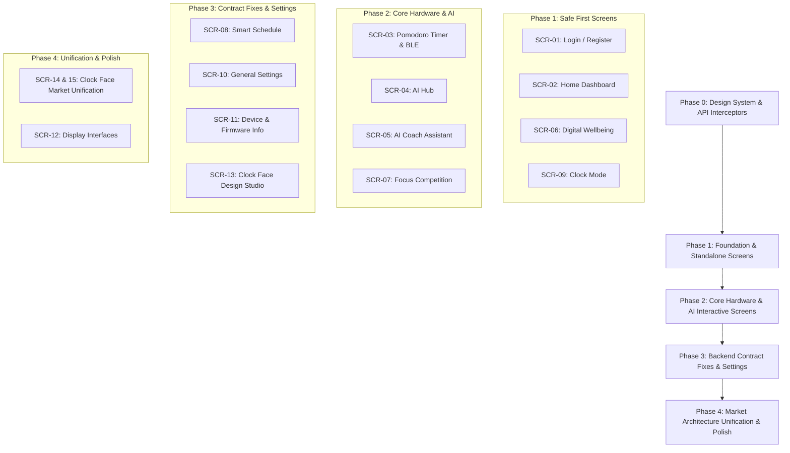

# UI Implementation Plan — Screen-by-Screen Roadmap

## 1. Implementation Strategy & Architectural Guardrails

This document establishes the step-by-step implementation plan for rebuilding and refining the user interface of **App_EXE401**, matching the visual designs in Google Stitch project `10749545399411306725` while preserving verified backend contracts and ESP32 hardware integrations.

### Guiding Principles
1. **Zero Breaking Changes to Existing Hardware Protocols**: The ESP32 Bluetooth Low Energy (GATT `0xFFE0`) and Bluetooth Classic SPP (`Pomodoro-App-Audio`) command formats are fixed in firmware. UI changes must route through existing `BluetoothService` and `HardwareService` abstractions without altering payload byte structures.
2. **Standardized Design Tokens First**: Before refactoring individual screens, a unified design system (`AppColors`, typography with GoogleFonts Inter/SpaceGrotesk, dynamic dark/light themes, elevation, border-radii) must be consolidated into `lib/core/theme/app_theme.dart` to eliminate the fragmented styling across screens.
3. **Phased Rollout with Regression Isolation**: Screens are executed in 4 distinct phases based on backend readiness, hardware coupling, and dependency risk.
4. **Backend-First Fixes for Broken Integrations**: For screens with active 404 or schema mismatch issues (`SCR-08`, `SCR-11`, `SCR-13`, `SCR-14`), backend endpoints must be corrected and verified before final frontend screen signoff.

---

## 2. Global Phase 0: Design System & Core Infrastructure Foundation

Prior to screen-level implementation, foundational tokens and client utilities must be unified.

| Component | Target File | Action Description | Dependencies |
| :--- | :--- | :--- | :--- |
| **Design Token System** | `lib/core/theme/app_colors.dart`, `app_theme.dart` | Consolidate primary (`#00F2FE`), secondary (`#4FACFE`), dark background (`#0A0E21`), glassmorphism card styles, and standard font styles (Space Grotesk for headers, Inter for body/inputs). | None |
| **API Client Unification** | `lib/core/constants/app_constants.dart`, `lib/core/network/api_client.dart` | Eliminate hardcoded IPs (`192.168.1.18:8000`) across screens; route all HTTP requests through a single Dio/Http client with JWT bearer interceptor and configurable `baseUrl`. | `SCR-01` |
| **Error Handling & Feedback** | `lib/core/widgets/app_snackbar.dart`, `loading_overlay.dart` | Standardize loading skeletons, error banners, and success feedback replacing ad-hoc `ScaffoldMessenger` popups. | AppTheme |

---

## 3. Implementation Phases Overview

---

## 4. Phase 1 — Foundation & Safe First Screens

These screens have stable, verified backend endpoints or operate locally without complex hardware state. They can be implemented safely without risking regressions.

### Screen 1: SCR-01 — Login & Authentication Screen
- **Screen ID**: `SCR-01`
- **Route**: `/login`
- **Priority**: Rank 1 (Entry gate for all authenticated sessions)
- **Files to Modify**:
  - `lib/presentation/screens/login_screen.dart`
  - `lib/providers/auth_provider.dart`
  - `lib/core/widgets/cyber_text_field.dart`
- **Backend Dependencies**:
  - `POST /api/v1/auth/login` (Verified working)
  - `POST /api/v1/auth/register` (Verified working)
- **Backend Compatibility Requirements**: None. Backend endpoints exist and are verified.
- **Acceptance Criteria**:
  1. Seamless toggle between Login and Register tabs with animated tab indicator.
  2. Form input validation for email format and password length (minimum 6 characters).
  3. Obscure/reveal password toggle on password input field.
  4. Display distinct loading state on the submit button with user interaction disabled.
  5. Error state with descriptive messages for HTTP 401 (invalid credentials) and HTTP 400 (duplicate email).
  6. Upon successful authentication, save JWT token and user profile into `SharedPreferences` and navigate to `/`.
- **Test Plan**:
  - Unit test `AuthProvider.login()` and `AuthProvider.register()` with mock Dio client.
  - Widget test form validation rules and error message rendering.
  - Integration test full login flow against local FastAPI server.

---

### Screen 2: SCR-02 — Home Dashboard Screen
- **Screen ID**: `SCR-02`
- **Route**: `/`
- **Priority**: Rank 2 (Application hub)
- **Files to Modify**:
  - `lib/presentation/screens/home_screen.dart`
  - `lib/presentation/widgets/device_status_card.dart`
  - `lib/presentation/widgets/feature_navigation_grid.dart`
  - `lib/providers/device_provider.dart`
- **Backend Dependencies**: None (Reads local device state and orchestrates navigation).
- **Backend Compatibility Requirements**: None.
- **Acceptance Criteria**:
  1. Header section displaying authenticated user greeting, current date, and quick profile avatar.
  2. Device Status Card reflecting real-time connection state (`Connected`, `Connecting`, `Disconnected`) via `DeviceProvider`.
  3. Action buttons on Device Card for `Scan & Connect`, `Disconnect`, and `Sync Status`.
  4. Quick Stats bar summarizing today's focus minutes and session count.
  5. Responsive Grid / List of Feature Cards routing to:
     - Pomodoro Timer (`/pomodoro`)
     - AI Hub (`/ai-hub`)
     - Digital Wellbeing (`/wellbeing`)
     - Competition (`/competition`)
     - Smart Schedule (`/schedule`)
     - Clock Mode (`/clock_mode`)
     - Clock Market (`/market`)
     - System Info (`/info`)
     - Settings (`/settings`)
  6. Smooth pull-to-refresh to re-query device connection status and recent stats.
- **Test Plan**:
  - Widget test for device connection state changes (`Disconnected` -> `Connecting` -> `Connected`).
  - Navigation test ensuring each grid card invokes the correct named route.

---

### Screen 3: SCR-06 — Digital Wellbeing Screen
- **Screen ID**: `SCR-06`
- **Route**: `/wellbeing`
- **Priority**: Rank 3 (Read-heavy, isolated data analytics)
- **Files to Modify**:
  - `lib/presentation/screens/wellbeing_screen.dart`
  - `lib/providers/wellbeing_provider.dart`
- **Backend Dependencies**:
  - `GET /api/v1/wellbeing/summary` (Verified working)
  - `GET /api/v1/wellbeing/hourly` (Verified working)
  - `GET /api/v1/wellbeing/daily` (Verified working)
- **Backend Compatibility Requirements**: None. Endpoints match frontend schemas.
- **Acceptance Criteria**:
  1. Top summary banner displaying total screen time, total unlock count, and daily focus score.
  2. Bar chart / line chart rendering hourly screen usage breakdown using `fl_chart`.
  3. Weekly trend chart showing daily total minutes compared to historical baseline.
  4. App breakdown list showing top distracting apps with time spent and percentage of total.
  5. Shimmer loading state while fetching summary and time series data.
  6. Empty state fallback with "No usage data recorded yet" if API returns zero records.
- **Test Plan**:
  - Unit test `WellbeingProvider` parsing of JSON responses for summary, hourly, and daily metrics.
  - Widget test chart rendering with sample datasets and zero-value datasets.

---

### Screen 4: SCR-09 — Clock Mode Control Screen
- **Screen ID**: `SCR-09`
- **Route**: `/clock_mode`
- **Priority**: Rank 4 (Clean ESP32 command mapping)
- **Files to Modify**:
  - `lib/presentation/screens/clock_mode_screen.dart`
  - `lib/services/hardware_service.dart`
- **Backend Dependencies**: None (Direct ESP32 BLE GATT / SPP commands).
- **Backend Compatibility Requirements**: None.
- **Acceptance Criteria**:
  1. Interactive mode selection carousel or grid:
     - Digital Clock
     - Analog Clock
     - Cyberpunk / Neon Face
     - Minimalist / Word Clock
     - Weather & Environmental Display
  2. Active mode indicator highlighting the currently configured clock mode.
  3. Brightness slider (0% to 100%) transmitting real-time PWM brightness commands.
  4. 12-hour vs 24-hour format toggle switch.
  5. Auto-sync time button sending current smartphone epoch timestamp to ESP32 RTC.
  6. Fallback UI showing warning badge if ESP32 device is disconnected.
- **Test Plan**:
  - Mock `HardwareService` to verify correct command strings are dispatched on mode selection (`{"cmd":"SET_CLOCK_MODE","mode":"cyberpunk"}`).
  - Widget test brightness slider debounce behavior (prevent flooding Bluetooth channel).

---

## 5. Phase 2 — Core Hardware & AI Interactive Screens

These screens represent the core competitive advantage of the product, requiring real-time state synchronization between ESP32 hardware, local state, and FastAPI AI pipelines.

### Screen 5: SCR-03 — Pomodoro Timer Screen
- **Screen ID**: `SCR-03`
- **Route**: `/pomodoro`
- **Priority**: Rank 5 (Core product capability)
- **Files to Modify**:
  - `lib/presentation/screens/pomodoro_screen.dart`
  - `lib/providers/pomodoro_provider.dart`
  - `lib/services/hardware_service.dart`
- **Backend Dependencies**:
  - `POST /api/v1/pomodoro/sessions` (Verified working)
  - `GET /api/v1/pomodoro/sessions/today` (Verified working)
  - ESP32 BLE GATT `0xFFE1` & Bluetooth SPP JSON commands
- **Backend Compatibility Requirements**: Replace mocked unlock count in `PomodoroScreen` with live query from `GET /api/v1/wellbeing/summary`.
- **Acceptance Criteria**:
  1. Circular animated countdown timer reflecting remaining focus / break seconds.
  2. Mode switcher between Focus (25m), Short Break (5m), and Long Break (15m) with configurable durations.
  3. Start, Pause, Resume, and Skip controls with immediate visual feedback.
  4. Real-time synchronization with ESP32: starting timer sends `{"cmd":"START_POMODORO","duration":1500}` to ESP32 display.
  5. Session completion trigger: plays audio chime, logs session to `POST /api/v1/pomodoro/sessions`, and increments daily stats.
  6. Unlock counter displaying actual device unlock count instead of hardcoded placeholder.
- **Test Plan**:
  - Test state machine transitions: Idle -> Running -> Paused -> Completed -> Break.
  - Verify sync payload structure sent to `HardwareService`.
  - Integration test session logging to backend on timer completion.

---

### Screen 6: SCR-04 — AI Productivity Hub Screen
- **Screen ID**: `SCR-04`
- **Route**: `/ai-hub`
- **Priority**: Rank 6 (AI Insights and recommendations)
- **Files to Modify**:
  - `lib/presentation/screens/ai_hub_screen.dart`
  - `lib/providers/ai_provider.dart`
- **Backend Dependencies**:
  - `GET /api/v1/ai/recommendations` (Verified working)
  - `POST /api/v1/ai/generate-schedule` (Verified working)
- **Backend Compatibility Requirements**: None. Endpoints match.
- **Acceptance Criteria**:
  1. Top AI Executive Summary card displaying daily focus score and productivity assessment generated by Gemini.
  2. Recommendations card list displaying actionable productivity tips with priority indicators (High, Medium, Low).
  3. "Generate Optimized Schedule" button triggering Gemini tool-calling scheduler with loading animation.
  4. Floating Action Button or prominent card opening the `AIAssistantScreen` (`SCR-05`).
  5. Pull-to-refresh to re-analyze recent wellbeing and pomodoro data.
- **Test Plan**:
  - Mock `AiProvider` to verify rendering of varied recommendation counts and tags.
  - Widget test error state when Gemini backend service encounters rate limit (HTTP 429).

---

### Screen 7: SCR-05 — AI Coach Assistant Modal / Screen
- **Screen ID**: `SCR-05`
- **Route**: Sub-route / Modal from `SCR-04`
- **Priority**: Rank 7 (Live conversational agent)
- **Files to Modify**:
  - `lib/presentation/screens/ai_assistant_screen.dart`
  - `lib/providers/ai_provider.dart`
- **Backend Dependencies**:
  - `POST /api/v1/ai/coach/chat` (Verified working)
- **Backend Compatibility Requirements**: Connect the mocked "Digital Twin" radar chart to backend `/api/v1/wellbeing/summary` metrics.
- **Acceptance Criteria**:
  1. Conversational chat interface with message bubbles for User and AI Coach.
  2. Support for markdown rendering in AI responses (bullet points, bold text).
  3. Interactive schedule confirmation cards when AI invokes the schedule generation tool.
  4. Quick prompt suggestions ("How was my focus today?", "Plan my afternoon", "Why is my unlock count high?").
  5. Digital Twin personality radar chart displaying Focus, Consistency, Recovery, and Discipline scores derived from actual user history.
  6. Streaming or typing indicator while waiting for Gemini API response.
- **Test Plan**:
  - Chat state management test ensuring messages append chronologically and maintain session context.
  - Error handling test for offline network scenarios with message retry capability.

---

### Screen 8: SCR-07 — Focus Competition & Leaderboard Screen
- **Screen ID**: `SCR-07`
- **Route**: `/competition`
- **Priority**: Rank 8 (Social gamification)
- **Files to Modify**:
  - `lib/presentation/screens/competition_screen.dart`
  - `lib/providers/competition_provider.dart`
- **Backend Dependencies**:
  - `GET /api/v1/competition/leaderboard` (Verified working)
  - `GET /api/v1/competition/my-rank` (Verified working)
- **Backend Compatibility Requirements**: None. Backend endpoints are operational.
- **Acceptance Criteria**:
  1. Top 3 Podium visualization for 1st, 2nd, and 3rd place with user avatars, badges, and focus scores.
  2. Sticky bottom bar showing the current logged-in user's rank, avatar, name, and total focus minutes.
  3. Ranked scrollable leaderboard list for ranks 4 through 50 with level indicators and tier badges.
  4. Timeframe filter tabs: Daily, Weekly, and All-Time leaderboards.
  5. Pull-to-refresh to update live rankings.
- **Test Plan**:
  - Widget test podium rendering with varying scores.
  - Verify sticky bottom rank card accurately highlights the current user.

---

## 6. Phase 3 — Backend Contract Fixes & Settings Screens

These screens require coordinated frontend and backend updates due to route prefix mismatches, field naming discrepancies, or missing persistence logic.

### Screen 9: SCR-08 — Smart Schedule Screen
- **Screen ID**: `SCR-08`
- **Route**: `/schedule`
- **Priority**: Rank 9 (Broken API integration fix required)
- **Required Backend Fix**:
  - In `backend/routers/schedule_router.py`: Ensure router is mounted under `/api/v1/schedules` or create rewrite.
  - In `backend/domain/schedules/schedule_entity.py`: Harmonize schedule model. Support either standard `{"title", "time", "days_of_week", "is_active"}` or update frontend `ScheduleProvider` to send `{"day_of_week", "hour", "minute", "label"}`.
- **Files to Modify**:
  - `lib/presentation/screens/schedule_screen.dart`
  - `lib/providers/schedule_provider.dart`
  - `backend/routers/schedule_router.py`
  - `backend/domain/schedules/`
- **Acceptance Criteria**:
  1. Calendar / weekly agenda view displaying active focus blocks and scheduled routines.
  2. Schedule list showing time, title, recurring days, and active toggle switch.
  3. Floating action button opening "Add Schedule" modal with title, time picker, and day chips.
  4. Toggle switch updates schedule active status via `PUT /api/v1/schedules/{id}`.
  5. Swipe-to-delete item triggers `DELETE /api/v1/schedules/{id}` with undo snackbar.
  6. Empty state with "No schedules set. Tap + or ask AI Coach to generate a routine".
- **Test Plan**:
  - Backend integration test for `GET`, `POST`, `PUT`, `DELETE` on `/api/v1/schedules`.
  - Frontend provider test verifying payload serialization and deserialization against the fixed schema.

---

### Screen 10: SCR-10 — General Settings Screen
- **Screen ID**: `SCR-10`
- **Route**: `/settings`
- **Priority**: Rank 10 (Replace mock snackbars with real persistence)
- **Required Backend Fix**:
  - Activate backend endpoint `PUT /api/v1/auth/me/preferences` to persist user settings in MongoDB `users` collection.
- **Files to Modify**:
  - `lib/presentation/screens/settings_screen.dart`
  - `lib/providers/auth_provider.dart`
  - `backend/routers/auth_router.py`
- **Acceptance Criteria**:
  1. Account section: Profile photo, display name, email, change password trigger, and logout button.
  2. Device Preferences section: Auto-reconnect toggle, BLE transmission power, telemetry interval.
  3. Notification Preferences: Daily summary alert, break reminders, competition rank updates.
  4. App Theme selector: Dark Mode (default), Cyberpunk Neon, Clean Light, Follow System.
  5. Save actions make actual HTTP call to `PUT /api/v1/auth/me/preferences` and persist to local storage.
  6. Logout clears JWT, resets providers, and redirects to `/login`.
- **Test Plan**:
  - Test persistence of toggle switches across app restart using `SharedPreferences`.
  - Verify logout flow completely clears user state and hardware Bluetooth connections.

---

### Screen 11: SCR-11 — System & Firmware Info Screen
- **Screen ID**: `SCR-11`
- **Route**: `/info`
- **Priority**: Rank 11 (Fix route prefix and field mismatch)
- **Required Backend Fix**:
  - Mount firmware router under `/api/v1/firmware` (currently at `/api/v1/firmware/latest`).
  - Harmonize response field: frontend expects `description`, backend returns `changelog`.
- **Files to Modify**:
  - `lib/presentation/screens/info_screen.dart`
  - `backend/routers/firmware_router.py`
- **Acceptance Criteria**:
  1. Device card showing connected ESP32 MAC address, current firmware version, and battery percentage.
  2. App card showing Flutter client version and build number.
  3. Firmware Update Card: checks `GET /api/v1/firmware/latest`, displays latest version, release date, and formatted changelog.
  4. "Check for Updates" button triggering real-time query with progress spinner.
  5. "Update Firmware" button disabled if already up-to-date; initiates OTA transfer if update is available.
- **Test Plan**:
  - Verify `GET /api/v1/firmware/latest` returns 200 with matching schema.
  - Widget test rendering when firmware is up-to-date vs update available.

---

### Screen 12: SCR-13 — Clock Face Design Studio Screen
- **Screen ID**: `SCR-13`
- **Route**: `/design`
- **Priority**: Rank 12 (Fix hardcoded IP and test image upload)
- **Files to Modify**:
  - `lib/presentation/screens/design_screen.dart`
  - Replace hardcoded `http://192.168.1.18:8000` with `AppConstants.baseUrl`.
  - Backend `backend/routers/market_router.py` or `design_router.py`
- **Acceptance Criteria**:
  1. Canvas preview showing simulated ESP32 ST7789 display (240x240 pixels).
  2. Image picker allowing user to select or crop custom watch face background.
  3. Text style controls: font family, font size, primary color, secondary color.
  4. Widget placement toggles: Show Date, Show Battery, Show Focus Minutes, Show Weather.
  5. "Preview on Device" sending temporary bitmap buffer over Bluetooth SPP.
  6. "Publish to Market" uploading face metadata and thumbnail via authenticated API.
- **Test Plan**:
  - Test image compression to ensure uploaded images do not exceed ESP32 SPIFFS buffer limits.
  - Verify API request uses dynamic `AppConstants.baseUrl` with JWT header.

---

## 7. Phase 4 — Market Architecture Unification & Polish

These screens address architectural fragmentation between legacy monolithic code and unused Clean Architecture modules.

### Screen 13 & 14: SCR-14 / SCR-15 — Clock Face Market Unification
- **Screen IDs**: `SCR-14` (Legacy Monolith) & `SCR-15` (Clean Architecture Domain)
- **Route**: `/market`
- **Priority**: Rank 13 (Architectural cleanup & feature activation)
- **Architectural Decision**:
  - Deprecate monolithic `lib/presentation/screens/market_screen.dart` (`SCR-14`).
  - Adopt and register Clean Architecture `presentation/screens/market_screen.dart` (`SCR-15`) backed by `domain/market/market_repository.dart` and `providers/market_provider.dart`.
  - Ensure backend router `backend/routers/market_router.py` is mounted at `/api/v1/market/`.
- **Files to Modify**:
  - `lib/main.dart` (Update route import to clean architecture screen)
  - `lib/domain/market/market_repository.dart`
  - `lib/providers/market_provider.dart`
  - `backend/routers/market_router.py`
- **Acceptance Criteria**:
  1. Category tabs: Featured, Minimal, Cyberpunk, Animated, Community.
  2. Grid view displaying clock face cards with thumbnail, title, author, rating, and download count.
  3. Detail view bottom sheet showing high-res preview, color variations, and author notes.
  4. "Apply to Device" button streaming selected binary clock face to ESP32 via Bluetooth SPP.
  5. Download progress indicator during binary stream transfer.
  6. Empty state and search filter for browsing available watch faces.
- **Test Plan**:
  - Unit test `MarketProvider` with mock repository.
  - Verify clean architecture dependency injection in `main.dart`.

---

### Screen 15: SCR-12 — Display Interfaces Configuration Screen
- **Screen ID**: `SCR-12`
- **Route**: `/interfaces`
- **Priority**: Rank 14 (Orphan route resolution)
- **Files to Modify**:
  - `lib/presentation/screens/interfaces_screen.dart`
  - `lib/presentation/screens/home_screen.dart` (Add entry point or merge into Clock Mode)
- **Acceptance Criteria**:
  1. Add navigation tile in `HomeScreen` grid or link directly inside `SCR-09` (Clock Mode).
  2. Configure active screen elements (Header, Battery Widget, Productivity Bar, Motivational Quote).
  3. Refresh rate and sleep timeout sliders.
  4. Real-time preview card demonstrating on-screen layout.
  5. "Save & Sync" pushing display layout flags to ESP32 via BLE GATT.
- **Test Plan**:
  - Verify navigation path from Home screen.
  - Verify ESP32 payload serialization for display configuration.

---

## 8. Summary Implementation Matrix

| Order | Screen ID | Screen Name | Phase | Risk Level | Backend Status | Dependencies |
| :---: | :--- | :--- | :---: | :---: | :---: | :--- |
| **0** | **SYS-00** | Design System & API Interceptor | Phase 0 | Low | Ready | Theme tokens, Dio client |
| **1** | **SCR-01** | Login & Register Screen | Phase 1 | Low | Ready (`/api/v1/auth`) | SYS-00 |
| **2** | **SCR-02** | Home Dashboard Screen | Phase 1 | Low | Ready | SYS-00, SCR-01 |
| **3** | **SCR-06** | Digital Wellbeing Screen | Phase 1 | Low | Ready (`/api/v1/wellbeing`) | SYS-00 |
| **4** | **SCR-09** | Clock Mode Control Screen | Phase 1 | Low | Local / BLE | SYS-00, BluetoothService |
| **5** | **SCR-03** | Pomodoro Timer Screen | Phase 2 | Medium | Ready (`/api/v1/pomodoro`) | SYS-00, HardwareService |
| **6** | **SCR-04** | AI Productivity Hub | Phase 2 | Medium | Ready (`/api/v1/ai`) | SYS-00, AiProvider |
| **7** | **SCR-05** | AI Coach Assistant Modal | Phase 2 | Medium | Ready (`/api/v1/ai/coach`) | SYS-00, SCR-04 |
| **8** | **SCR-07** | Focus Competition Screen | Phase 2 | Low | Ready (`/api/v1/competition`)| SYS-00 |
| **9** | **SCR-08** | Smart Schedule Screen | Phase 3 | High | Requires Fix (`/v1` prefix) | Backend router fix |
| **10**| **SCR-10** | General Settings Screen | Phase 3 | Low | Requires Endpoint | Backend preferences API |
| **11**| **SCR-11** | System & Firmware Info | Phase 3 | Medium | Requires Fix (`changelog`) | Backend router fix |
| **12**| **SCR-13** | Clock Face Design Studio | Phase 3 | Medium | Requires Fix (Hardcoded IP)| API endpoint fix |
| **13**| **SCR-14/15**| Clock Face Market | Phase 4 | High | Requires Unification | Backend market router |
| **14**| **SCR-12** | Display Interfaces Screen | Phase 4 | Low | Unreachable in Home | Navigation link |

---

## 9. Quality Assurance & Regression Testing Strategy

For each implemented screen:
1. **Static Analysis**: Run `flutter analyze` ensuring zero warnings, deprecation notes, or unused imports.
2. **Contract Verification**: Use automated integration tests to assert that every HTTP request contains `Authorization: Bearer <token>` and expects HTTP 200 with schema validation.
3. **Bluetooth Protocol Safety**: Validate that BLE payloads dispatched to `0xFFE1` strictly conform to the 20-byte MTU and JSON structure specified in `3_API_BLUETOOTH_PROTOCOL.md`.
4. **Visual Regression**: Compare rendered Flutter widgets against Google Stitch designs in project `10749545399411306725` across both 360x800 and 412x915 device viewports.
