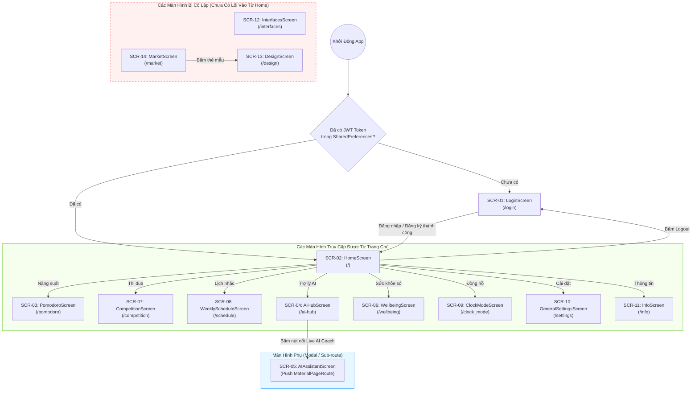
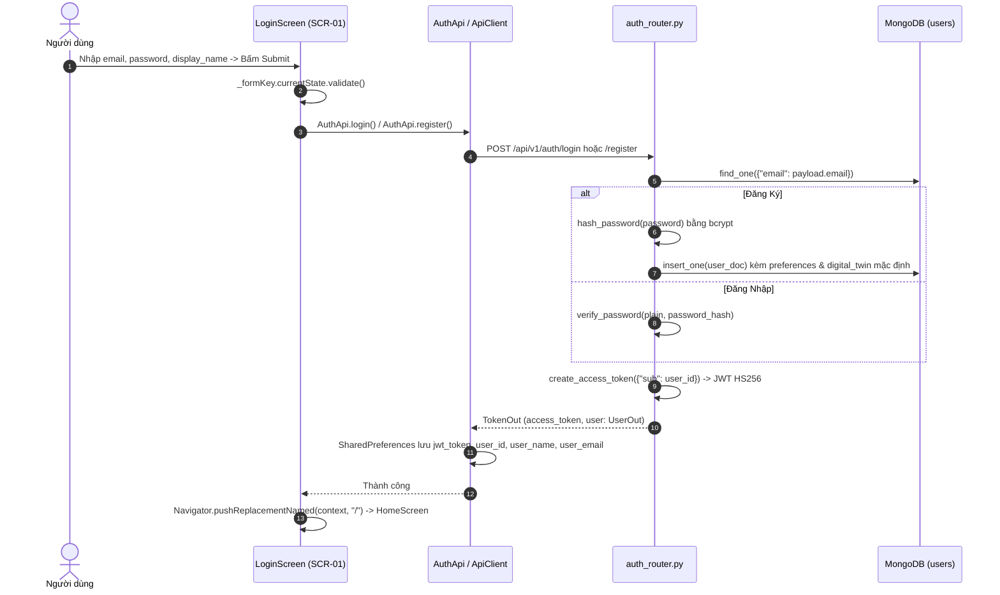
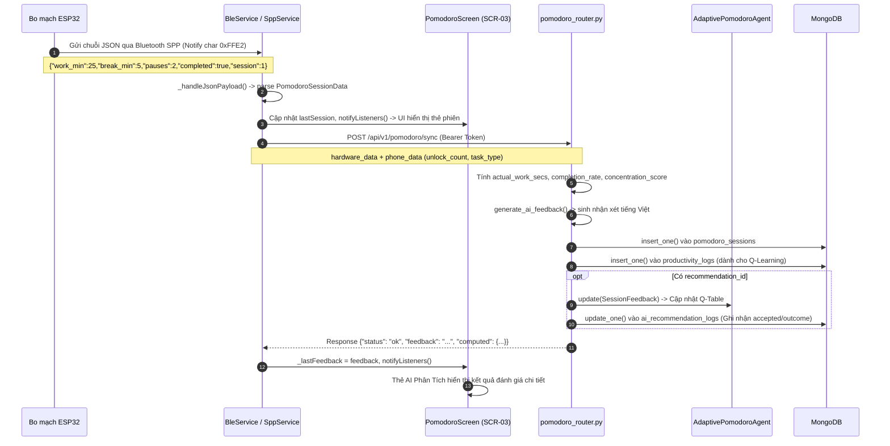
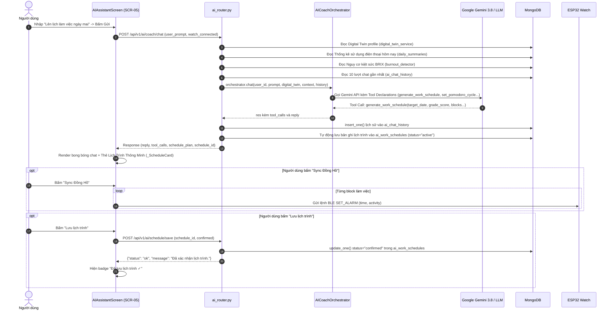
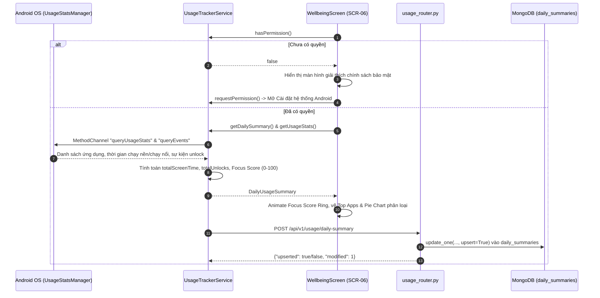
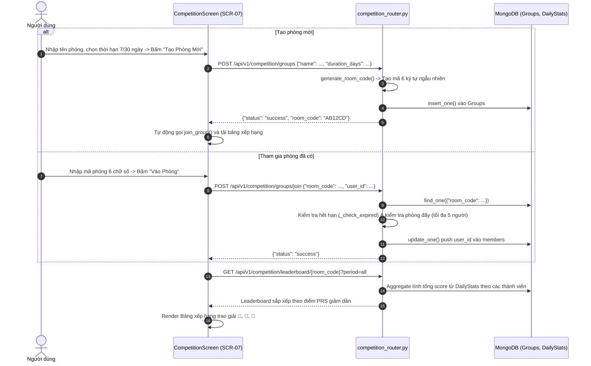
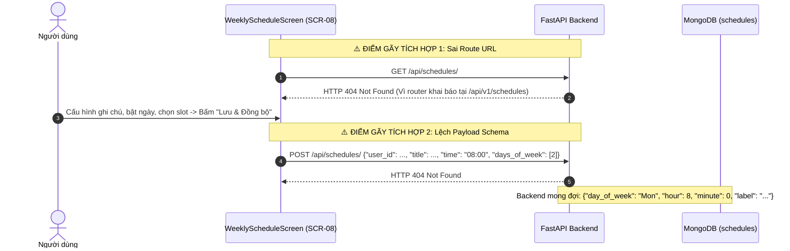
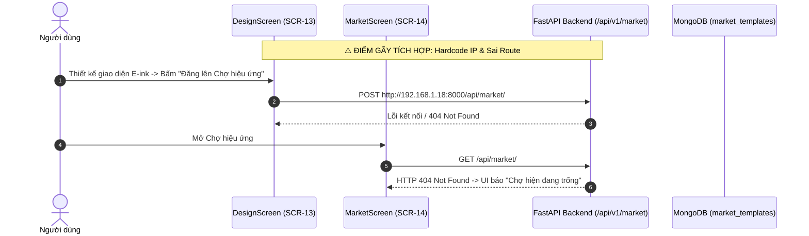

# LUỒNG NGƯỜI DÙNG & DÒNG CHẢY DỮ LIỆU ĐẦU-CUỐI (USER FLOWS & DATA FLOW)
**Dự án:** Smart Pomodoro Watch × AI Productivity Ecosystem  
**Ngày kiểm toán:** 15/10/2026  
**Cơ sở kiểm toán:** Đối chiếu trực tiếp mã nguồn Flutter, FastAPI, Motor/MongoDB và firmware ESP32.

---

## 1. SƠ ĐỒ ĐIỀU HƯỚNG TỔNG THỂ (APPLICATION NAVIGATION MAP)

---

## 2. CHI TIẾT CÁC LUỒNG DỮ LIỆU ĐẦU-CUỐI (END-TO-END DATA FLOWS)

---

### LUỒNG 1: XÁC THỰC NGƯỜI DÙNG & QUẢN LÝ PHIÊN (AUTHENTICATION & SESSION FLOW)

- **Bước 1: Hành động người dùng:** Nhập thông tin tài khoản và bấm "Đăng Nhập" hoặc "Tạo Tài Khoản".
  - *Tập tin:* [login_screen.dart](file:///c:/EXE401_WEDAPP_PROJECT_REPORT/App_EXE401/Frontend_EXE401/lib/features/auth/login_screen.dart#L41-L62) (`_submit`)
- **Bước 2: Xử lý sự kiện UI:** `_formKey.currentState!.validate()` kiểm tra email và độ dài mật khẩu.
- **Bước 3: Tầng Service Frontend:** [auth_api.dart](file:///c:/EXE401_WEDAPP_PROJECT_REPORT/App_EXE401/Frontend_EXE401/lib/core/api/auth_api.dart#L9-L36) (`AuthApi.login` / `register`) -> [api_client.dart](file:///c:/EXE401_WEDAPP_PROJECT_REPORT/App_EXE401/Frontend_EXE401/lib/core/api/api_client.dart#L58-L65) (`ApiClient.post`).
- **Bước 4: Backend Route:** [auth_router.py](file:///c:/EXE401_WEDAPP_PROJECT_REPORT/App_EXE401/Backend_EXE401/api/v1/auth_router.py#L28-L88) (`POST /api/v1/auth/login` hoặc `/register`).
- **Bước 5: Logic nghiệp vụ & Database:**
  - Kiểm tra trùng email (khi đăng ký).
  - Băm hoặc đối soát mật khẩu qua thư viện `bcrypt` trực tiếp ([security.py](file:///c:/EXE401_WEDAPP_PROJECT_REPORT/App_EXE401/Backend_EXE401/core/security.py#L23-L31)).
  - Tạo token JWT có thời hạn 7 ngày (`ACCESS_TOKEN_EXPIRE_MINUTES = 10080`).
  - Ghi bản ghi vào collection `users` trong MongoDB.
- **Bước 6: Cập nhật State & Kết quả:** Frontend nhận JSON, lưu token và profile vào `SharedPreferences`, giải phóng form và điều hướng vào trang chủ.
- **Phân loại trạng thái:** ✅ **Hoàn thành và kiểm thử thành công (Implemented & Verified)**

---

### LUỒNG 2: ĐỒNG BỘ PHIÊN POMODORO PHẦN CỨNG ESP32 & PHẢN HỒI AI (POMODORO SYNC FLOW)

- **Bước 1: Hành động phần cứng:** Phiên đếm giờ trên ESP32 kết thúc (hoặc bấm Reset), firmware gọi `sendPomodoroData()` xuất chuỗi JSON qua Bluetooth SPP.
- **Bước 2: Frontend Service đón nhận:** [ble_service.dart](file:///c:/EXE401_WEDAPP_PROJECT_REPORT/App_EXE401/Frontend_EXE401/lib/core/bluetooth/ble_service.dart#L127-L137) giải mã UTF-8 từ characteristic `0xFFE2` -> đẩy vào Stream -> [spp_service.dart](file:///c:/EXE401_WEDAPP_PROJECT_REPORT/App_EXE401/Frontend_EXE401/lib/core/bluetooth/spp_service.dart#L124-L135) parse thành `PomodoroSessionData`.
- **Bước 3: Gọi API Backend:** [spp_service.dart](file:///c:/EXE401_WEDAPP_PROJECT_REPORT/App_EXE401/Frontend_EXE401/lib/core/bluetooth/spp_service.dart#L138-L191) đóng gói `hardware_data` + `phone_data` gọi `POST /api/v1/pomodoro/sync` qua `ApiClient`.
- **Bước 4: Backend Route & Logic tính điểm:** [pomodoro_router.py](file:///c:/EXE401_WEDAPP_PROJECT_REPORT/App_EXE401/Backend_EXE401/api/v1/pomodoro_router.py#L129-L265):
  - Tính thời gian làm thực tế `actual_work_secs` từ RTC DS3231.
  - Tính phạt xao nhãng: `distraction_penalty = (pauses * 5.0) + (unlocks * 10.0)`.
  - Tính điểm tập trung nhân theo tỷ lệ hoàn thành: `conc_score = round(quality_score * (comp_rate / 100.0), 1)`.
  - Sinh phản hồi cá nhân hóa bằng tiếng Việt qua hàm `generate_ai_feedback`.
- **Bước 5: Lưu trữ & Vòng lặp học máy (Feedback Loop):**
  - Lưu vào collection `pomodoro_sessions`.
  - Ghi nhật ký vào `productivity_logs`.
  - Nếu phiên bắt nguồn từ gợi ý của AI Coach (`recommendation_id` hợp lệ), kích hoạt `AdaptivePomodoroAgent.update` cập nhật bảng Q-table và ghi nhận kết quả vào `ai_recommendation_logs`.
- **Bước 6: Phản hồi UI:** [pomodoro_screen.dart](file:///c:/EXE401_WEDAPP_PROJECT_REPORT/App_EXE401/Frontend_EXE401/lib/features/pomodoro/pomodoro_screen.dart#L256-L315) hiển thị thẻ AI Phân Tích màu xanh tím đậm.
- **Phân loại trạng thái:** 🟡 **Hoàn thành một phần (Partially Implemented - Unlock Count đang bị mock)**

---

### LUỒNG 3: TRÒ CHUYỆN VỚI AI COACH & SINH LỊCH TRÌNH THÔNG MINH (AI COACH CHAT & SCHEDULING FLOW)

- **Bước 1: Hành động người dùng:** Mở `AIAssistantScreen`, nhập yêu cầu tư vấn hoặc lên kế hoạch.
- **Bước 2: Xử lý sự kiện UI:** Thêm tin nhắn user vào danh sách, cuộn xuống đáy, gọi `ApiClient.post('/api/v1/ai/coach/chat')`.
- **Bước 3: Tổng hợp Ngữ cảnh tại Backend ([ai_router.py](file:///c:/EXE401_WEDAPP_PROJECT_REPORT/App_EXE401/Backend_EXE401/api/v1/ai_router.py#L235-L408)):**
  - Lấy Digital Twin profile từ `DigitalTwinService`.
  - Lấy thời tiết từ `ContextService`.
  - Tính toán nguy cơ kiệt sức từ `BurnoutDetector`.
  - Lấy dữ liệu sử dụng điện thoại thực tế từ collection `daily_summaries`.
  - Truy vấn 10 lượt hội thoại gần nhất từ `ai_chat_history`.
- **Bước 4: Điều phối LLM ([ai_coach_orchestrator.py](file:///c:/EXE401_WEDAPP_PROJECT_REPORT/App_EXE401/Backend_EXE401/application/ai/ai_coach_orchestrator.py)):** Kích hoạt Gemini 3.8 / Flash với các công cụ Tool Calling.
- **Bước 5: Xử lý kết quả:**
  - Nếu có công cụ `generate_work_schedule`, Backend tự sinh UUID và lưu vào collection `ai_work_schedules`.
  - Trả về payload hoàn chỉnh cho Flutter.
- **Bước 6: Phản hồi UI:**
  - Nếu có công cụ phần cứng thông thường: Gửi lệnh BLE ngay (`SET_POMO`, `SET_ALARM`, `SHOW_NOTIF`).
  - Nếu có lịch trình: Render widget `_ScheduleCard` với timeline chi tiết, điểm Grade và các nút bấm đồng bộ.
- **Phân loại trạng thái:** 🟡 **Hoàn thành một phần (Partially Implemented - Radar Chart Digital Twin đang dùng dữ liệu mock)**

---

### LUỒNG 4: GIÁM SÁT SỨC KHỎE SỐ & ĐỒNG BỘ NỀN (DIGITAL WELLBEING FLOW)

- **Bước 1: Kiểm tra quyền hệ thống:** [usage_tracker_service.dart](file:///c:/EXE401_WEDAPP_PROJECT_REPORT/App_EXE401/Frontend_EXE401/lib/core/usage_tracking/usage_tracker_service.dart#L27-L45) gọi `checkPermission` qua `MethodChannel('com.daonguyen.iot47/usage_stats')`.
- **Bước 2: Thu thập số liệu:** Truy vấn `UsageStatsManager` của Android để lấy dữ liệu từ 00:00 hôm nay đến hiện tại.
- **Bước 3: Phân loại danh mục:** Phân loại ứng dụng thành `Productivity`, `Social Media`, `Games`, `Entertainment`...
- **Bước 4: Tính điểm Focus Score:**
  $$\text{Focus Score} = \left(1.0 - \frac{\text{Thời gian xao nhãng}}{\text{Tổng thời gian màn hình}}\right) \times 100$$
  *(Kèm hệ số phạt nếu số lần mở khóa quá 50 hoặc 100 lần/ngày).*
- **Bước 5: Đồng bộ máy chủ:** Gọi `POST /api/v1/usage/daily-summary` đẩy kết quả lên MongoDB để AI Coach sử dụng làm ngữ cảnh.
- **Phân loại trạng thái:** ✅ **Đã hoàn thành trên Android (Implemented & Verified on Android)**

---

### LUỒNG 5: ĐẤU TRƯỜNG NĂNG SUẤT THI ĐUA NHÓM (PRODUCTIVITY COMPETITION FLOW)

- **Bước 1: Hành động người dùng:** Tạo phòng hoặc nhập mã phòng thi đua 6 ký tự.
- **Bước 2: Xử lý tại Backend ([competition_router.py](file:///c:/EXE401_WEDAPP_PROJECT_REPORT/App_EXE401/Backend_EXE401/api/v1/competition_router.py)):**
  - Tạo nhóm mới: Sinh mã UUID 6 ký tự, ghi vào collection `Groups`.
  - Tham gia nhóm: Kiểm tra thời hạn dựa trên `created_at + duration_days`. Giới hạn tối đa 5 người/phòng để đảm bảo tính cạnh tranh cao.
- **Bước 3: Chấm điểm PRS (Productivity Ranking Score):**
  $$\text{PRS} = \text{Phút làm việc} + (\text{Hoàn thành} \times 15) - (\text{Số lần Pause} \times 10)$$
- **Bước 4: Tổng hợp xếp hạng:** Dùng MongoDB Aggregation Pipeline tổng hợp điểm số từ collection `DailyStats` theo bộ lọc thời gian (`today`, `week`, `month`, `all`).
- **Phân loại trạng thái:** ✅ **Đã hoàn thành (Implemented - Cần cải thiện tự động lấy user_id từ token)**

---

### LUỒNG 6: ĐỒNG BỘ THỜI KHÓA BIỂU TUẦN (WEEKLY SCHEDULE FLOW) — [HIỆN TRẠNG LỖI]

- **Phân loại trạng thái:** ❌ **Hỏng tích hợp (Broken Integration)**
- **Khắc phục yêu cầu:**
  1. Cập nhật URL trong [weekly_schedule_screen.dart](file:///c:/EXE401_WEDAPP_PROJECT_REPORT/App_EXE401/Frontend_EXE401/lib/features/schedule/weekly_schedule_screen.dart) thành `${AppConstants.baseUrl}/api/v1/schedules/`.
  2. Chuẩn hóa Schema: Đồng nhất giữa cấu trúc `title`/`time`/`days_of_week` (kiểu lịch thực tế) và `ScheduleEntity` của Backend.

---

### LUỒNG 7: THIẾT KẾ & ĐĂNG HIỆU ỨNG LÊN CHỢ (DESIGN STUDIO & MARKETPLACE FLOW) — [HIỆN TRẠNG LỖI]

- **Phân loại trạng thái:** ❌ **Hỏng tích hợp & Bị cô lập (Broken Integration & Unreachable)**
- **Khắc phục yêu cầu:**
  1. Thêm nút truy cập "Chợ Hiệu Ứng" và "Thiết Kế Màn Hình" vào `HomeScreen`.
  2. Chuyển sang sử dụng [presentation/screens/market_screen.dart](file:///c:/EXE401_WEDAPP_PROJECT_REPORT/App_EXE401/Frontend_EXE401/lib/features/market/presentation/screens/market_screen.dart) (Clean Architecture) đã dùng chuẩn `/api/v1/market`.
  3. Xóa bỏ IP hardcode `192.168.1.18:8000` trong `design_screen.dart`.

---

## 3. BẢNG PHÂN LOẠI TRẠNG THÁI TOÀN BỘ CÁC TÍNH NĂNG ỨNG DỤNG

| Tính Năng / Luồng Nghiệp Vụ | File Frontend | File Backend | Trạng Thái Phân Loại | Bằng Chứng Kỹ Thuật |
|---|---|---|---|---|
| **Đăng Ký & Đăng Nhập JWT** | `features/auth/login_screen.dart` | `api/v1/auth_router.py` | ✅ Implemented & Verified | Mã hóa bcrypt chuẩn, cấp JWT 7 ngày, lưu SharedPreferences an toàn |
| **Lấy Thông Tin Người Dùng Me** | `core/api/auth_api.dart` | `api/v1/auth_router.py` | ✅ Implemented & Verified | Endpoint `/me` giải mã Bearer token, trả về thông tin cá nhân |
| **Đồng Bộ Phiên Pomodoro ESP32** | `core/bluetooth/spp_service.dart` | `api/v1/pomodoro_router.py` | 🟡 Partially Implemented | Luồng BLE -> API -> DB hoạt động tốt; Số lần unlock điện thoại đang bị mock |
| **Gợi Ý Adaptive Pomodoro AI** | `features/ai_hub/ai_hub_screen.dart` | `api/v1/ai_router.py` | ✅ Implemented & Verified | Q-Learning Agent sinh chu kỳ dựa trên điểm tập trung và lịch sử |
| **Đo Lường Nguy Cơ Kiệt Sức** | `features/ai_hub/ai_hub_screen.dart` | `api/v1/ai_router.py` | ✅ Implemented & Verified | BurnoutDetector tính BRIX proxy dựa trên 15 ngày dữ liệu thực |
| **Huấn Luyện Viên AI Hôm Nay** | `features/ai_hub/ai_hub_screen.dart` | `api/v1/ai_router.py` | ✅ Implemented & Verified | Trả về lời khuyên kèm các chỉ số thống kê trung bình |
| **Trò Chuyện AI Coach Trực Tiếp** | `features/ai_hub/ai_assistant_screen.dart` | `api/v1/ai_router.py` | 🟡 Partially Implemented | Chat Gemini & Tool Calling hoạt động; Biểu đồ radar Digital Twin bị mock |
| **Sinh Lịch Trình Làm Việc AI** | `features/ai_hub/ai_assistant_screen.dart` | `api/v1/ai_router.py` | ✅ Implemented & Verified | Tool call tự động sinh `schedule_plan` và đồng bộ báo thức BLE |
| **Giám Sát Sức Khỏe Số Android** | `features/digital_wellbeing/wellbeing_screen.dart` | `api/v1/usage_router.py` | ✅ Implemented (Android) | Đọc `UsageStats` native, tính Focus Score, đồng bộ `daily_summaries` |
| **Đấu Trường Thi Đua Nhóm** | `features/competition/competition_screen.dart` | `api/v1/competition_router.py` | ✅ Implemented & Verified | Tạo phòng 6 ký tự, tính điểm PRS, bảng xếp hạng 4 mốc thời gian |
| **Đổi Giao Diện Mặt Đồng Hồ** | `features/clock_mode/clock_mode_screen.dart` | Firmware ESP32 | ✅ Implemented (BLE) | Gửi lệnh `SET_MODE` và `SET_THEME` qua BLE trực tiếp |
| **Đồng Bộ Giờ Thực RTC** | `features/general_settings/general_settings_screen.dart` | Bo mạch DS3231 | ✅ Implemented (BLE) | Hàm `ble.syncTime()` gửi lệnh `SET_TIME` qua BLE |
| **Cài Đặt Phần Cứng Nâng Cao** | `features/general_settings/general_settings_screen.dart` | Không | 🔶 Mocked / Hardcoded | 5 nút lưu cài đặt chỉ hiển thị SnackBar, không lưu dữ liệu |
| **Thời Khóa Biểu Tuần** | `features/schedule/weekly_schedule_screen.dart` | `api/v1/schedule_router.py` | ❌ Broken Integration | Lỗi HTTP 404 (sai endpoint) và lệch Schema dữ liệu |
| **Kiểm Tra & Cập Nhật Firmware** | `features/info/info_screen.dart` | `api/v1/firmware_router.py` | ❌ Broken Integration | Lỗi HTTP 404 (sai endpoint) và lệch tên trường `description` |
| **Studio Thiết Kế Màn Hình** | `features/design/design_screen.dart` | `api/v1/market_router.py` | ❌ Broken & Unreachable | Lỗi HTTP 404; hardcode IP; không có lối vào từ Trang Chủ |
| **Chợ Mẫu Giao Diện E-Ink** | `features/market/market_screen.dart` | `api/v1/market_router.py` | ❌ Broken & Unreachable | Lỗi HTTP 404; hardcode IP; không có lối vào từ Trang Chủ |
| **Quản Lý 9 Màn Hình Xoay Vòng** | `features/interfaces/interfaces_screen.dart` | Không | ⛔ Unreachable & Mocked | Màn hình bị cô lập; danh sách cứng trong RAM; nút lưu giả lập |
